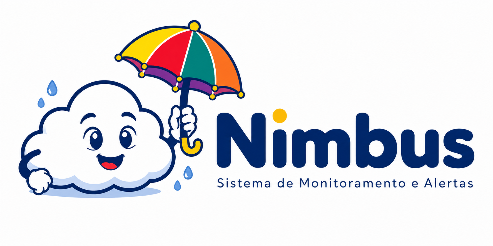

<div align="center">



### Sistema Integrado de Dados e Alertas Meteorológicos

**Monitoramento em tempo real · Alertas preventivos · Inteligência climática para a RMR**

---

[](https://python.org)
[](https://cloud.google.com)
[](https://cloud.google.com/dataform)
[](https://www.prefect.io)
[](https://laravel.com)
[](https://www.postgresql.org)
[](https://nextjs.org)
[](https://docker.com)
[](https://prometheus.io)

</div>

---

## 🌧️ O Problema

A **Região Metropolitana do Recife (RMR)** é historicamente uma das áreas urbanas mais vulneráveis a desastres climáticos extremos no Brasil. Tempestades severas, enchentes, deslizamentos de encostas e ressacas marinhas colocam milhões de vidas em risco periodicamente.

Historicamente, as informações climáticas operam de forma isolada: dados pluviométricos (APAC, CEMADEN), modelos de previsão numérica globais e estatísticas sociodemográficas (IBGE) estão dispersos em portais distintos, com formatos heterogêneos e sem uma camada de inteligência integrada.

**O Nimbus existe para conectar esses pontos e antecipar o impacto.**

---

## 🎯 O Que é o Nimbus

O **Nimbus** é uma plataforma analítica e operacional de monitoramento e inteligência climática de alta resolução construída especificamente para a Região Metropolitana do Recife.

A plataforma automatiza a ingestão de dados em tempo real, organiza um Data Lakehouse em nuvem (arquitetura Medallion), processa transformações no BigQuery via Dataform e expõe insights analíticos, painéis e APIs para subsidiar decisões preventivas e defesa civil.

> *Nimbus é a palavra em latim para nuvem de tempestade — aquela que anuncia a chuva antes de ela chegar.*

---

## 📦 O Que Entregamos

### 🔴 Monitoramento em Tempo Real
Coleta contínua de temperatura, umidade, índice UV, velocidade/rajadas de vento e precipitação para os **14 municípios da RMR**, integrando dados observados e modelos de alta resolução.

### ⚠️ Alertas Preventivos e Nowcasting
Algoritmos orientados a limiares críticos configuráveis para detecção antecipada de eventos extremos: enchentes, deslizamentos e tempestades severas (com horizontes de 15 minutos a 12 horas).

### 🌊 Previsão Oceânica e Costeira
Monitoramento contínuo das condições marítimas em **9 pontos costeiros estratégicos da RMR** (incluindo o Porto do Recife, Porto de Suape e principais orlas), com leituras de altura/período de ondas, direção do swell e ventos marítimos.

### 📅 Série Histórica desde 1961
Integração e preservação histórica de pluviometria do estado de Pernambuco (APAC), cobrindo as 5 mesorregiões desde 1961, permitindo análises comparativas e identificação de anomalias climáticas.

### 🧑‍🤝‍🧑 Vulnerabilidade Sociodemográfica
Cruzamento dos dados de telemetria climática com informações censitárias do **IBGE 2022** por setor e bairro, permitindo mapear a população exposta e priorizar áreas de maior vulnerabilidade habitacional.

### 📍 Relatos Colaborativos de Campo
Canal direto na API para registro de ocorrências pelos cidadãos e agentes locais (alagamentos, desabamentos, quedas de árvores), enriquecendo os modelos com validação em solo.

---

## 🗄️ Fontes de Dados Integradas

| Fonte | Mecanismo | Frequência | Dados Coletados |
| :--- | :--- | :--- | :--- |
| **CEMADEN** | API REST | A cada 15 min | Telemetria pluviométrica de estações automáticas da RMR |
| **Open-Meteo** | API REST | A cada 1h | Condições atuais e previsão horária/diária de tempo |
| **Open-Meteo Marine** | API REST | A cada 1h | Condições marítimas, ondas, swell e marés em 9 pontos |
| **Tomorrow.io** | API REST | A cada 1h | Nowcasting meteorológico hiperlocal de alta precisão |
| **APAC PE** | Web Scraping Headless | Diário | Pluviometria diária e série histórica desde 1961 |
| **IBGE Censo 2022** | Carga Analítica | Estático | Indicadores de população, domicílios e densidade |
| **IBGE Malha GPKG** | Geoprocessamento | Estático | Polígonos e limites territoriais de bairros e municípios |

---

## 🏗️ Arquitetura da Plataforma

O Nimbus adota o padrão **Medallion Architecture (Lakehouse)** com processamento em nuvem no **Google Cloud Platform (GCP)** e infraestrutura de orquestração dedicada na **MagaluCloud**:

```
 [Fontes Externas] (APIs REST / Web Scraping Headless)
         │
         ▼  (Orquestrado via Prefect 3)
 🥉 CAMADA BRONZE (Google Cloud Storage)
    gs://nimbus-506613-bronze-* (Arquivos Parquet particionados por data)
         │
         ▼  (Transformações SQLX via GCP Dataform)
 🥈 CAMADA SILVER (Google BigQuery)
    Dados limpos, tipados, deduplicados e enriquecidos com metadados
         │
         ▼  (Transformações SQLX via GCP Dataform)
 🥇 CAMADA GOLD (Google BigQuery)
    Agregações analíticas, matrizes de risco, acumulados pluviométricos e demografia
         │
    ┌────┴───────────────────────────┐
    ▼                                ▼
⚡ Laravel 11 REST API          🌐 Next.js Dashboard
(Rotas, Autenticação,             (Interface visual, mapas,
 Relatos de Usuários)              painéis de monitoramento)
```

### Divisão de Infraestrutura:
* **Google Cloud Platform (GCP):**
  * **Google Cloud Storage (GCS):** Data Lake com buckets particionados por fonte na camada Bronze.
  * **Google BigQuery:** Data Warehouse corporativo para dados Silver e Gold.
  * **Google Dataform:** Pipeline de engenharia de dados declarativo em SQLX para governança e transformação.
* **VM Dedicada (MagaluCloud - Debian):**
  * Hospeda o **Prefect Server** e **Prefect Worker** executando os pipelines em regime 24/7.
  * Hospeda a stack completa de **Observabilidade** e o runner de deploy contínuo (`self-hosted`).

---

## 🛠️ Stack Tecnológica

| Camada | Tecnologias Utilizadas |
| :--- | :--- |
| **Ingestão & Pipelines** | Python 3.12, Requests, Pandas, Selenium (Chrome Headless), PyArrow, GCSfs |
| **Orquestração** | Prefect 3 (Server, Worker autônomo, agendamentos cron/interval) |
| **Data Lake & DW** | Google Cloud Storage (GCS) e Google BigQuery |
| **Transformações** | GCP Dataform (SQLX, assertions, dependências modulares) |
| **Backend & API** | PHP 8.2, Laravel 11, PostgreSQL 18 |
| **Frontend** | TypeScript, Next.js, React, Tailwind CSS |
| **Observabilidade** | Prometheus, Grafana, Node Exporter, cAdvisor |
| **DevOps & Automação** | Docker Compose, Taskfile (`go-task`), GitHub Actions CI/CD |

---

## 🗂️ Estrutura do Repositório

```text
nimbus-platform/
├── api/                # Backend Laravel 11 (Rotas REST, migrations, controllers, models)
├── data/               # Dados estáticos auxiliares (metadados e geoespaciais)
├── dataform/           # Repositório GCP Dataform (modelos SQLX Bronze, Silver, Gold)
│   ├── definitions/    # Definições de tabelas, views e assertions
│   └── includes/       # Constantes e funções compartilhadas
├── docs/               # Documentação técnica de arquitetura, redes e guias de uso
├── monitoring/         # Configurações de observabilidade (Prometheus & Grafana)
│   ├── grafana/        # Provisionamento automático de datasources e dashboards
│   └── prometheus/     # Coleta de métricas e regras de monitoramento
├── pipelines/          # Engenharia de dados e ingestão em Python
│   ├── config/         # Configurações globais e schemas
│   ├── extract/        # Scripts de coleta (APAC, CEMADEN, Open-Meteo, Tomorrow.io)
│   ├── flows/          # Workflows do Prefect e Dockerfile do Worker
│   └── storage/        # Adaptador de persistência no Google Cloud Storage (GCS)
├── web/                # Frontend em Next.js (Painel público, mapas e alertas)
├── docker-compose.yml  # Definição multi-container de todos os serviços locais/produção
├── Taskfile.yml        # Automação de comandos do ciclo de vida da aplicação
└── .env.example        # Modelo de variáveis de ambiente
```

---

## ⚡ Guia Rápido de Execução (Quickstart)

O projeto utiliza o **[Taskfile (`go-task`)](https://taskfile.dev)** para automação de tarefas.

### 1. Pré-requisitos
* **Docker** e **Docker Compose** instalados
* **Taskfile (`go-task`)** instalado ([guia de instalação](docs/guia-taskfile.md))

### 2. Configurar o Ambiente
Copie o modelo de variáveis de ambiente e preencha as chaves necessárias (GCP, APIs):
```bash
cp .env.example .env
```

### 3. Provisionar a Infraestrutura
Para subir todos os serviços e rodar as migrações automaticamente:
```bash
task setup
```

### 4. Portas e Serviços Locais
Após a inicialização, os serviços estarão disponíveis nos seguintes endereços:

| Serviço | Endereço | Descrição |
| :--- | :--- | :--- |
| 🌐 **Next.js Web** | `http://localhost:8080` | Interface visual do usuário final |
| ⚡ **Laravel API** | `http://localhost:8000` | Backend e endpoints REST |
| 🎛️ **Prefect UI** | `http://localhost:4200` | Painel de controle e histórico de pipelines |
| 📈 **Grafana** | `http://localhost:3001` | Dashboards de métricas *(admin / admin)* |
| 🔍 **Prometheus** | `http://localhost:9090` | Servidor de métricas |
| 🐘 **PostgreSQL** | `localhost:5432` | Banco relacional da API (`nimbus_app`) |

### Comandos Úteis do Taskfile
```bash
task --list         # Lista todos os comandos disponíveis
task status         # Exibe o status de todos os contêineres
task logs           # Exibe logs de todos os serviços em tempo real
task up:pipelines   # Sobe apenas o Prefect Server e Worker
task flow:deploy    # Registra os fluxos como deployments agendados no Prefect
task migrate        # Executa as migrations do Laravel
```

---

## 📚 Documentação Técnica Complementar

Para aprofundamento técnico, consulte os documentos detalhados na pasta [`docs/`](docs/):

* [Plano Diretor e Arquitetura da Plataforma](docs/plano-diretor.md)
* [Engenharia e Arquitetura de Dados (Bronze, Silver e Gold)](docs/arquitetura-e-dados.md)
* [Guia de Provisionamento e Uso do Taskfile](docs/guia-taskfile.md)
* [Guia Prático de Docker](docs/guia-docker.md)
* [Documentação dos Modelos Dataform](dataform/README.md)
* [Contrato das Rotas da API](docs/api-contrato.md)
* [Estratégia de Branches e Versionamento](docs/estrategia-branches.md)
* [Histórico e Documentos Arquivados](docs/legacy/README.md)

---

## 🚀 Status dos Módulos

| Módulo | Componente | Status |
| :--- | :--- | :--- |
| Ingestão de Dados (Bronze) | Python + GCS | ✅ Operacional em Produção |
| Orquestração de Fluxos | Prefect 3 (Server + Worker na VM) | ✅ Operacional 24/7 |
| Data Warehouse | BigQuery (Bronze, Silver, Gold) | ✅ Operacional |
| Transformações Analíticas | GCP Dataform (SQLX) | ✅ Modelos estruturados |
| Backend & API REST | Laravel 11 + PostgreSQL | ✅ Operacional |
| Observabilidade & Métricas | Prometheus + Grafana + cAdvisor | ✅ Operacional |
| Frontend & Dashboards | Next.js | 🔄 Em desenvolvimento ativo |
| Deploy Contínuo (CI/CD) | GitHub Actions (Self-Hosted Runner na VM) | ✅ Automatizado |

---

<div align="center">

**Nimbus · Região Metropolitana do Recife · 2026**  
*Dados e tecnologia que antecipam tempestades e salvam vidas.*

</div>
