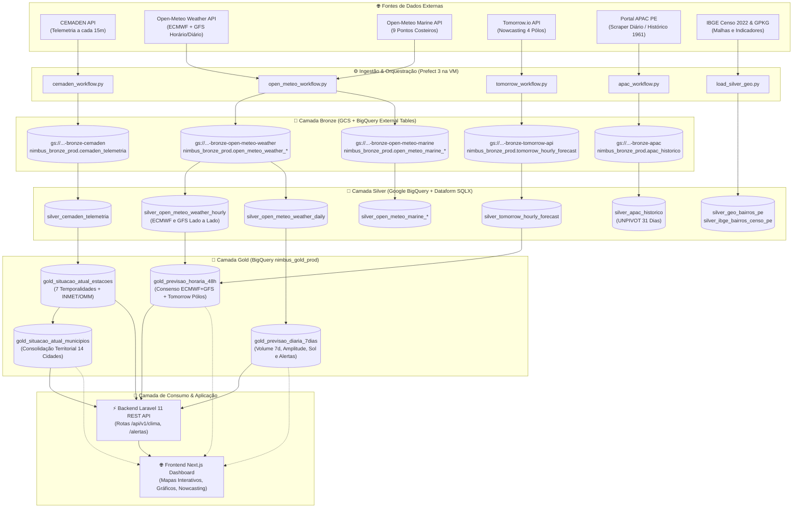

# 🌩️ Engenharia e Arquitetura de Dados — Plataforma Nimbus

> **Projeto:** Nimbus — Plataforma Integrada de Monitoramento e Alertas Climáticos da Região Metropolitana do Recife (RMR)  
> **Ambiente Cloud:** Google Cloud Platform (GCP) — Projeto `nimbus-506613` | Região `southamerica-east1` (São Paulo)  
> **Orquestração e Execução:** Prefect 3.x + Google Cloud Dataform (SQLX)  
> **Consumo:** Backend Laravel 11 (API REST) & Frontend Next.js (Dashboard Analítico)  
> **Versão do Documento:** 2.0 (Unificado & Oficial) — Novembro de 2026  

---

## 📑 Sumário Executivo

1. [0. Arquitetura de Dados & Stack Tecnológica](#0-arquitetura-de-dados--stack-tecnológica)
   - [1.1 Padrão Medallion Lakehouse em Nuvem](#11-padrão-medallion-lakehouse-em-nuvem)
   - [1.2 Diagrama de Fluxo Ponta a Ponta](#12-diagrama-de-fluxo-ponta-a-ponta)
   - [1.3 Stack Tecnológica e Papéis dos Componentes](#13-stack-tecnológica-e-papéis-dos-componentes)
   - [1.4 Topologia de Ambientes (GCP vs VM Dedicada)](#14-topologia-de-ambientes-gcp-vs-vm-dedicada)
2. [1. Fontes de Dados do Projeto](#1-fontes-de-dados-do-projeto)
   - [2.1 CEMADEN (Centro Nacional de Monitoramento e Alertas)](#21-cemaden-centro-nacional-de-monitoramento-e-alertas)
   - [2.2 Open-Meteo Weather API (Modelos Globais Terrestres)](#22-open-meteo-weather-api-modelos-globais-terrestres)
   - [2.3 Open-Meteo Marine API (Oceanografia & Condições Costeiras)](#23-open-meteo-marine-api-oceanografia--condições-costeiras)
   - [2.4 Tomorrow.io API (Nowcasting Hiperlocal & Pólos Sentinela)](#24-tomorrowio-api-nowcasting-hiperlocal--pólos-sentinela)
   - [2.5 APAC PE (Série Histórica Pluviométrica desde 1961)](#25-apac-pe-série-histórica-pluviométrica-desde-1961)
   - [2.6 Dados Censitários e Geoespaciais (IBGE 2022 & GPKG)](#26-dados-censitários-e-geoespaciais-ibge-2022--gpkg)
3. [2. Ingestão de Dados (Pipelines & Orquestração)](#2-ingestão-de-dados-pipelines--orquestração)
   - [3.1 Arquitetura de Orquestração com Prefect 3](#31-arquitetura-de-orquestração-com-prefect-3)
   - [3.2 Catálogo de Fluxos e Agendamentos (Deployments)](#32-catálogo-de-fluxos-e-agendamentos-deployments)
   - [3.3 Padrão dos Scripts de Extração (Python)](#33-padrão-dos-scripts-de-extração-python)
   - [3.4 Resiliência, Retries e Isolamento por Tags](#34-resiliência-retries-e-isolamento-por-tags)
4. [3. Camada Bronze (Google Cloud Storage & External Tables)](#3-camada-bronze-google-cloud-storage--external-tables)
   - [4.1 Estrutura de Buckets no GCS](#41-estrutura-de-buckets-no-gcs)
   - [4.2 Particionamento Hive e Compressão Snappy](#42-particionamento-hive-e-compressão-snappy)
   - [4.3 Catálogo de Tabelas Externas do BigQuery (`nimbus_bronze_prod`)](#43-catálogo-de-tabelas-externas-do-bigquery-nimbus_bronze_prod)
   - [4.4 Padronização e Migração do Scraper APAC](#44-padronização-e-migração-do-scraper-apac)
5. [4. Camada Silver (Limpeza, Deduplicação & Modelagem Dataform)](#4-camada-silver-limpeza-deduplicação--modelagem-dataform)
   - [5.1 Governança Analítica e Padrões SQLX](#51-governança-analítica-e-padrões-sqlx)
   - [5.2 Catálogo de Modelos Silver (`nimbus_silver_prod`)](#52-catálogo-de-modelos-silver-nimbus_silver_prod)
   - [5.3 Destaque de Modelagem: UNPIVOT Matricial APAC](#53-destaque-de-modelagem-unpivot-matricial-apac)
   - [5.4 Tratamento de Timestamps ISO com Minutos](#54-tratamento-de-timestamps-iso-com-minutos)
   - [5.5 Consolidação Censitária IBGE 2022 (6 CSVs para 1 Tabela)](#55-consolidação-censitária-ibge-2022-6-csvs-para-1-tabela)
6. [5. Camada Gold (Inteligência, Agregações & Suporte à Decisão)](#5-camada-gold-inteligência-agregações--suporte-à-decisão)
   - [6.1 Princípios de Design da Camada Gold](#61-princípios-de-design-da-camada-gold)
   - [6.2 Monitoramento em Tempo Real (Observado CEMADEN)](#62-monitoramento-em-tempo-real-observado-cemaden)
     - [`gold_situacao_atual_estacoes`: 7 Temporalidades e Escala INMET/OMM](#gold_situacao_atual_estacoes-7-temporalidades-e-escala-inmetomm)
     - [`gold_situacao_atual_municipios`: Consolidação Territorial dos 14 Municípios](#gold_situacao_atual_municipios-consolidação-territorial-dos-14-municípios)
   - [6.3 Previsão Meteorológica Multi-modelo](#63-previsão-meteorológica-multi-modelo)
     - [`gold_previsao_horaria_48h`: Consenso, Divergência e Herança por Pólos Sentinela](#gold_previsao_horaria_48h-consenso-divergência-e-herança-por-pólos-sentinela)
     - [`gold_previsao_diaria_7dias`: Acumulados 7 Dias, Amplitude Térmica e Sol](#gold_previsao_diaria_7dias-acumulados-7-dias-amplitude-térmica-e-sol)
   - [6.4 Matriz de Consumo pela Aplicação (Next.js & Laravel)](#64-matriz-de-consumo-pela-aplicação-nextjs--laravel)

---

# 0. Arquitetura de Dados & Stack Tecnológica

### 1.1 Padrão Medallion Lakehouse em Nuvem
A plataforma adota o padrão de **Arquitetura Medalhão (Bronze ➔ Silver ➔ Gold)** diretamente sobre serviços gerenciados do Google Cloud Platform, operando sob o conceito de **Zero-Copy Data Lakehouse**:

* **Camada Raw / Bronze:** Os dados brutos ingeridos por scripts Python são gravados em buckets do **Google Cloud Storage (GCS)** em arquivos compactados Parquet Snappy. No **Google BigQuery**, são registradas **Tabelas Externas (External Tables)** apontando diretamente para esses buckets com particionamento Hive. Dessa forma, o armazenamento é pago apenas no GCS, sem custos de ingestão duplicados no BigQuery.
* **Camada Silver:** Modelos SQLX orquestrados pelo **Google Cloud Dataform** realizam a tipagem defensiva (`SAFE_CAST`), deduplicação estrita via janelas temporais (`QUALIFY ROW_NUMBER()`), conversão matricial e particionamento diário nativo no BigQuery.
* **Camada Gold:** Tabelas de agregação analítica no BigQuery formatadas em snapshots operacionais de altíssima performance para consumo da aplicação, com leituras instantâneas de baixa latência e custo por consulta próximo de zero.

---

### 1.2 Diagrama de Fluxo Ponta a Ponta



---

### 1.3 Stack Tecnológica e Papéis dos Componentes

| Componente | Tecnologia | Papel na Plataforma |
| :--- | :--- | :--- |
| **Linguagem Base** | Python 3.12 | Motores de extração, scraping, serialização Parquet e tarefas Prefect. |
| **Data Lake Storage** | Google Cloud Storage (GCS) | Repositório de arquivos brutos particionados com retenção histórica. |
| **Data Warehouse** | Google BigQuery | Processamento analítico distribuído, particionado e colunar das camadas Bronze, Silver e Gold. |
| **Engenharia Analítica** | Google Cloud Dataform (SQLX) | Compilação declarativa do DAG de transformações, dependências modulares e asserções. |
| **Orquestrador de Fluxos** | Prefect 3.x | Agendamento cron, execução distribuída de tarefas, políticas de retry e chamadas do Dataform CLI. |
| **Containers & Host** | Docker & Docker Compose | Isolamento das stacks do Prefect Worker, Prefect Server, PostgreSQL e Observabilidade em VM Debian. |
| **Backend REST** | PHP 8.2 & Laravel 11 | API corporativa com controle de autenticação, endpoints de consumo e canal de relatos de campo. |
| **Frontend Web** | TypeScript, React & Next.js | Dashboard de alta fidelidade visual com mapas (Leaflet), séries temporais e alertas em tempo real. |

---

### 1.4 Topologia de Ambientes (GCP vs VM Dedicada)

A infraestrutura opera de forma híbrida:
1. **Google Cloud Platform (GCP):**
   * Projeto: `nimbus-506613` | Região: `southamerica-east1` (São Paulo).
   * Hospeda os buckets GCS e os 3 datasets do BigQuery: `nimbus_bronze_prod`, `nimbus_silver_prod` e `nimbus_gold_prod`.
   * Executa as transformações computacionais serverless do Dataform diretamente nos nós do BigQuery.
2. **Servidor Virtual Dedicado (Debian na MagaluCloud):**
   * Host: `nimbus-server-prod`.
   * Roda o container autônomo `nimbus_prefect_worker`, responsável pela execução dos fluxos agendados 24/7.
   * Roda o banco local de metadados do Prefect (PostgreSQL) e a stack de monitoramento (Prometheus, Grafana, Node Exporter).

---

# 1. Fontes de Dados do Projeto

| Fonte | Tipo de Extração | Frequência | Granularidade | Descrição / Cobertura |
| :--- | :--- | :--- | :--- | :--- |
| **CEMADEN** | API REST JSON | A cada 15 min | Por estação física | 284 estações pluviométricas telemétricas em PE (14 municípios da RMR monitorados). |
| **Open-Meteo Weather** | API REST JSON | A cada 1 hora | Por município (14) | Previsão horária de 7 dias e diária dos modelos ECMWF IFS 0.4° e GFS Seamless NOAA. |
| **Open-Meteo Marine** | API REST JSON | A cada 1 hora | Por ponto costeiro (9) | Ondas, swell (ondulação), período, correntes e marés para o litoral da RMR. |
| **Tomorrow.io** | API REST JSON | A cada 1 hora | 4 Pólos Sentinela | Nowcasting de alta resolução (12 horas à frente) cobrindo os 4 quadrantes da RMR. |
| **APAC PE** | Web Scraping Headless | Diário (madrugada) | Por posto pluviométrico | Histórico diário desde 1961 para todos os postos oficiais de Pernambuco. |
| **IBGE Censo 2022** | Carga CSV Estática | Carga Única | Por Bairro Oficial | Indicadores de população, alfabetização, renda, esgotamento e vulnerabilidade. |
| **IBGE Geometrias** | Arquivo GeoPackage (GPKG) | Carga Única | Polígonos Geográficos | Limites territoriais dos 705 bairros e 185 municípios de Pernambuco (EPSG:4326). |

---

# 2. Ingestão de Dados (Pipelines & Orquestração)

### 2.1 Arquitetura de Orquestração com Prefect 3
A orquestração não utiliza cronjobs de sistema operacional diretamente. Todos os pipelines são fluxos do **Prefect 3**, gerenciados por deployments versionados e executados por um worker dedicado dentro do container `nimbus_prefect_worker`.

### 2.2 Catálogo de Fluxos e Agendamentos (Deployments)

```text
Prefect Server (Deployments)
 ├── cemaden-ingestion-flow/cemaden-api-deployment    (Intervalo: a cada 15 min)
 ├── open-meteo-full-flow/open-meteo-api-deployment   (Intervalo: a cada 1 hora)
 ├── tomorrow-io-ingestion-flow/tomorrow-api-deploy   (Intervalo: a cada 1 hora)
 └── apac-ingestion-flow/apac-scrape-deployment       (Cron: diário às 03:00 UTC)
```

1. **`cemaden_workflow.py`:**
   * Executa `task_fetch_cemaden()`: consulta a API pública do CEMADEN para o estado de Pernambuco.
   * Executa `task_save_cemaden()`: salva arquivos Parquet em `gs://nimbus-506613-bronze-cemaden/cemaden/uf=PE/ano=YYYY/mes=MM/dia=DD/`.
   * Dispara a transformação via Dataform: `task_run_dataform(tags=["cemaden"])`.
2. **`open_meteo_workflow.py`:**
   * Executa 6 tarefas de extração paralela: clima atual, previsão diária, previsão horária, marés atuais, marés diárias e marés horárias.
   * Salva os Parquets nos respectivos buckets de clima e costeiro.
   * Dispara as transformações via Dataform: `task_run_dataform(tags=["open_meteo"])` e `task_run_dataform(tags=["marine"])`.
3. **`tomorrow_workflow.py`:**
   * Requisita o endpoint `/v4/weather/forecast` da Tomorrow.io para as coordenadas geográficas dos 4 Pólos Sentinela da RMR.
   * Salva em `gs://nimbus-506613-bronze-tomorrow-api/hourly_forecast/`.
   * Dispara a transformação via Dataform: `task_run_dataform(tags=["tomorrow_io"])`.
4. **`apac_workflow.py`:**
   * Executa o crawler com Selenium (Chrome Headless) no portal da APAC, raspando a matriz mensal de chuvas para as 5 mesorregiões de PE.
   * Salva em `gs://nimbus-506613-bronze-apac/chuva/`.
   * Dispara a transformação via Dataform: `task_run_dataform(tags=["apac"])`.

### 2.3 Resiliência, Retries e Isolamento por Tags
* **Políticas de Retry:** Todas as tarefas de extração externa têm retries automáticos (`retries=3, retry_delay_seconds=30`) para resistir a instabilidades transitórias de rede ou timeouts de APIs terceiras.
* **Isolamento por Tags:** O Dataform CLI é invocado com argumentos de tag específicos (`--tags <tag>`). Isso impede que o fluxo da CEMADEN, por exemplo, recompile modelos meteorológicos do Open-Meteo desnecessariamente, garantindo tempos de execução inferiores a 10 segundos por ciclo.

---

# 3. Camada Bronze (Google Cloud Storage & External Tables)

### 3.1 Estrutura de Buckets no GCS

| Bucket GCS | Prefixo de Armazenamento | Particionamento Hive | Frequência |
| :--- | :--- | :--- | :--- |
| `gs://nimbus-506613-bronze-cemaden` | `cemaden/uf=PE/` | `ano={ano}/mes={mes}/dia={dia}` | 15 min |
| `gs://nimbus-506613-bronze-open-meteo-weather` | `current/uf=PE/` | `ano={ano}/mes={mes}/dia={dia}` | 1 hora |
| `gs://nimbus-506613-bronze-open-meteo-weather` | `forecast_hourly/uf=PE/` | `data_extracao={data_extracao}` | 1 hora |
| `gs://nimbus-506613-bronze-open-meteo-weather` | `forecast_daily/uf=PE/` | `data_extracao={data_extracao}` | 1 hora |
| `gs://nimbus-506613-bronze-open-meteo-marine` | `current/uf=PE/` | `ano={ano}/mes={mes}/dia={dia}` | 1 hora |
| `gs://nimbus-506613-bronze-open-meteo-marine` | `forecast_hourly/uf=PE/` | `data_extracao={data_extracao}` | 1 hora |
| `gs://nimbus-506613-bronze-open-meteo-marine` | `forecast_daily/uf=PE/` | `data_extracao={data_extracao}` | 1 hora |
| `gs://nimbus-506613-bronze-tomorrow-api` | `hourly_forecast/` | `data_extracao={data_extracao}` | 1 hora |
| `gs://nimbus-506613-bronze-apac` | `chuva/` | `data_extracao={data_extracao}` | Diário |
| `gs://nimbus-506613-geo-complementares` | `censo/` e `geometrias/` | Sem partição temporal | Estático |

### 3.2 Catálogo de Tabelas Externas do BigQuery (`nimbus_bronze_prod`)

As tabelas externas utilizam os arquivos Parquet do GCS sem duplicar armazenamento:

```sql
-- Exemplo DDL: Tabela Externa CEMADEN com Particionamento Hive Triplo
CREATE OR REPLACE EXTERNAL TABLE `nimbus-506613.nimbus_bronze_prod.cemaden_telemetria`
WITH PARTITION COLUMNS (
    ano INT64,
    mes INT64,
    dia INT64
)
OPTIONS (
    format = 'PARQUET',
    hive_partition_uri_prefix = 'gs://nimbus-506613-bronze-cemaden/cemaden/uf=PE',
    uris = ['gs://nimbus-506613-bronze-cemaden/cemaden/uf=PE/*']
);
```

### 3.3 Padronização e Migração do Scraper APAC
O BigQuery impõe validações estritas de cabeçalho em arquivos Parquet (caracteres acentuados, espaços e barras são rejeitados). No extrator [`pipelines/extract/extract_apac.py`](file:///home/igortiburcio/Projetos/nimbus-platform/pipelines/extract/extract_apac.py):
1. Foi criada a função `padronizar_colunas_apac()`, renomeando as colunas matriciais de dias (`01` a `31`) para `dia_01` a `dia_31`, e cabeçalhos como `Mês/Ano` para `mes_ano` e `Código` para `codigo`.
2. Todos os mais de 300 arquivos Parquet históricos no bucket `gs://nimbus-506613-bronze-apac/` foram migrados com os novos cabeçalhos padronizados.

---

# 4. Camada Silver (Limpeza, Deduplicação & Modelagem Dataform)

### 5.1 Governança Analítica e Padrões SQLX
Todos os modelos em `dataform/definitions/silver/` operam sob rigorosos padrões:
* **Deduplicação Determinística:** Aplicação de `QUALIFY ROW_NUMBER() OVER (PARTITION BY <chave_primaria> ORDER BY data_extracao DESC) = 1` para manter apenas o dado mais recente em caso de reprocessamento.
* **Tipagem Defensiva:** Uso sistemático de `SAFE_CAST(...)` para prevenir falhas de compilação por dados nulos ou strings malformadas das APIs públicas.
* **Particionamento e Clustering Nativos:** Redução de custos e alta velocidade em consultas analíticas:
  * `partitionBy`: Campo de data relevante (ex: `data_extracao` ou `DATE(data_hora)`).
  * `clusterBy`: Chaves de alto filtro (ex: `cidade`, `codigo_estacao`, `ponto`).

### 5.2 Catálogo de Modelos Silver (`nimbus_silver_prod`)

| Modelo SQLX | Tipo Dataform | Chave Primária Natural | Partição / Cluster |
| :--- | :--- | :--- | :--- |
| `silver_cemaden_telemetria` | `incremental` | `codigo_estacao`, `data_hora` | Partition: `DATE(data_hora)`<br/>Cluster: `cidade`, `codigo_estacao` |
| `silver_open_meteo_weather_current` | `incremental` | `cidade`, `data_extracao`, `data_hora` | Partition: `data_extracao`<br/>Cluster: `cidade` |
| `silver_open_meteo_weather_hourly` | `incremental` | `cidade`, `data_extracao`, `data_hora_previsao` | Partition: `data_extracao`<br/>Cluster: `cidade` |
| `silver_open_meteo_weather_daily` | `incremental` | `cidade`, `data_extracao`, `data_previsao` | Partition: `data_extracao`<br/>Cluster: `cidade` |
| `silver_open_meteo_marine_current` | `incremental` | `ponto`, `data_extracao`, `data_hora` | Partition: `data_extracao`<br/>Cluster: `ponto` |
| `silver_open_meteo_marine_hourly` | `incremental` | `ponto`, `data_extracao`, `data_hora_previsao` | Partition: `data_extracao`<br/>Cluster: `ponto` |
| `silver_open_meteo_marine_daily` | `incremental` | `ponto`, `data_extracao`, `data_previsao` | Partition: `data_extracao`<br/>Cluster: `ponto` |
| `silver_tomorrow_hourly_forecast` | `incremental` | `cidade_base`, `data_ingestao`, `data_hora_previsao` | Partition: `data_ingestao`<br/>Cluster: `cidade_base` |
| `silver_apac_historico` | `table` | `codigo_estacao`, `data_medicao` | Partition: `data_medicao`<br/>Cluster: `codigo_estacao`, `municipio` |

### 5.3 Destaque de Modelagem: UNPIVOT Matricial APAC
A APAC publica medições diárias em formato matricial horizontal (colunas `dia_01` até `dia_31`). O modelo [`silver_apac_historico.sqlx`](file:///home/igortiburcio/Projetos/nimbus-platform/dataform/definitions/silver/silver_apac_historico.sqlx) desnormaliza essa matriz transformando-a em uma série temporal contínua:

```sql
WITH desnormalizado AS (
  SELECT
    SAFE_CAST(codigo AS STRING) AS codigo_estacao,
    mes_ano,
    SAFE_CAST(dia_str AS INT64) AS dia_mes,
    SAFE_CAST(chuva_mm_str AS FLOAT64) AS chuva_mm
  FROM ${ref("apac_historico")}
  UNPIVOT (
    chuva_mm_str FOR dia_str IN (
      dia_01 AS '1', dia_02 AS '2', ..., dia_31 AS '31'
    )
  )
)
```

### 5.4 Tratamento de Timestamps ISO com Minutos
As previsões horárias do Open-Meteo entregam datas no formato ISO sem segundos (`YYYY-MM-DDTHH:MM`). Para evitar que o BigQuery gere `NULL`, a conversão é tratada defensivamente:

```sql
COALESCE(
  SAFE_CAST(time AS TIMESTAMP),
  SAFE.PARSE_TIMESTAMP('%Y-%m-%dT%H:%M', time),
  SAFE.PARSE_TIMESTAMP('%Y-%m-%d %H:%M:%S', time)
) AS data_hora_previsao
```

### 5.5 Consolidação Censitária IBGE 2022
Em vez de manter 6 tabelas esparsas, os 6 arquivos CSV do Censo 2022 foram consolidados pelo script `pipelines/load/load_silver_geo.py` na tabela unificada [`silver_ibge_bairros_censo_pe`](file:///home/igortiburcio/Projetos/nimbus-platform/dataform/definitions/silver/):
* `Basico_PE.csv` (População residente, total de domicílios)
* `Alfabetizacao_PE.csv` (Taxa de alfabetização municipal e por bairro)
* `Domicilio_PE.csv` (Características físicas, abastecimento e esgotamento)
* `Entorno_PE.csv` (Infraestrutura urbana: bueiros, iluminação, pavimentação)
* `Pessoas_PE.csv` (Faixas etárias e grupos de risco: idosos e crianças)
* `Responsavel_PE.csv` (Chefia familiar e rendimento médio)

---

# 5. Camada Gold (Inteligência, Agregações & Suporte à Decisão)

### 6.1 Princípios de Design da Camada Gold
A camada Gold (`nimbus_gold_prod`) foi desenhada como a **Camada de Consumo Direto da Aplicação**:
1. **Estrutura tipo Snapshot Operacional (`type: "table"`):** As tabelas de tempo real e de previsão armazenam o estado atual mais recente. Assim, uma consulta do backend ou frontend lê apenas 14 ou 284 linhas no BigQuery, gerando tempo de resposta quase instantâneo (< 100 ms) e custo de processamento irrisório (10 MiB por varredura).
2. **Separação Rígida entre Medição Observada e Previsão Numérica:**
   * O **Monitoramento em Tempo Real** utiliza **exclusivamente dados reais medidos pelo CEMADEN**.
   * A **Previsão do Tempo** utiliza a comparação multi-modelo dos modelos matemáticos (ECMWF, GFS e Tomorrow.io).

---

### 6.2 Monitoramento em Tempo Real (Observado CEMADEN)

#### `gold_situacao_atual_estacoes`: 7 Temporalidades e Escala INMET/OMM
Localização: [`dataform/definitions/gold/gold_situacao_atual_estacoes.sqlx`](file:///home/igortiburcio/Projetos/nimbus-platform/dataform/definitions/gold/gold_situacao_atual_estacoes.sqlx)  
* **Granularidade:** 1 registro por estação telemétrica ativa do CEMADEN em Pernambuco (~284 estações).
* **7 Temporalidades de Chuva Observada:** Calcula de forma acumulada as janelas de **1h, 3h, 6h, 12h, 24h, 48h e 72h** em uma única varredura particionada no BigQuery.
* **Tendência de Curto Prazo:** Compara o ritmo dos últimos 60 minutos com a média das 3 horas anteriores:
  * `subindo`: ritmo da última 1h está acelerando $> 30\%$ em relação à média anterior.
  * `descendo`: chuva cessou ou diminuiu mais de $30\%$.
  * `estavel`: precipitação contínua em ritmo regular.
* **Escala Física de Intensidade (Padrão INMET / OMM):**

| Faixa de Intensidade | Critério Pluviométrico (1 hora) | Critério Pluviométrico (24 horas) |
| :--- | :--- | :--- |
| **Sem Chuva** | $0.0\text{ mm}$ | $0.0\text{ mm}$ |
| **Fraca** | $> 0.0\text{ e } < 5.0\text{ mm/h}$ | $> 0.0\text{ e } < 20.0\text{ mm/24h}$ |
| **Moderada** | $5.0 \le \text{chuva} < 20.0\text{ mm/h}$ | $20.0 \le \text{chuva} < 50.0\text{ mm/24h}$ |
| **Forte** | $20.0 \le \text{chuva} < 50.0\text{ mm/h}$ | $50.0 \le \text{chuva} < 100.0\text{ mm/24h}$ |
| **Muito Forte / Torrencial** | $\ge 50.0\text{ mm/h}$ | $\ge 100.0\text{ mm/24h}$ |

* **Status Operacional da Estação:** Compara a `ultima_leitura_timestamp` com o horário atual. Se transmitiu nas últimas 2 horas, recebe status `ativa`; caso contrário, `sem_transmissao_recente`.

---

#### `gold_situacao_atual_municipios`: Consolidação Territorial dos 14 Municípios
Localização: [`dataform/definitions/gold/gold_situacao_atual_municipios.sqlx`](file:///home/igortiburcio/Projetos/nimbus-platform/dataform/definitions/gold/gold_situacao_atual_municipios.sqlx)  
* **Granularidade:** Exatamente 14 linhas (1 para cada município da Região Metropolitana do Recife).
* **Máximos Operacionais Territoriais:** Crucial para Defesa Civil e segurança de vidas: registra o maior volume pontual em qualquer bairro da cidade (`chuva_max_1h_mm` a `chuva_max_72h_mm`).
* **Médias Territoriais:** Média ponderada da chuva em toda a extensão do município (`chuva_media_1h_mm` e `chuva_media_24h_mm`).
* **Metadados de Rede:** `total_estacoes`, `total_estacoes_ativas`, array com a lista dos códigos das estações (`estacoes_codigos`) e o nome da estação que registrou a chuva mais crítica (`estacao_mais_chuvosa_nome`).

---

### 6.3 Previsão Meteorológica Multi-modelo

#### `gold_previsao_horaria_48h`: Consenso, Divergência e Herança por Pólos Sentinela
Localização: [`dataform/definitions/gold/gold_previsao_horaria_48h.sqlx`](file:///home/igortiburcio/Projetos/nimbus-platform/dataform/definitions/gold/gold_previsao_horaria_48h.sqlx)  
* **Granularidade:** 672 registros ($14 \text{ municípios} \times 48 \text{ horas à frente}$).
* **Modelos Lado a Lado:** Expõe as previsões puras de cada modelo meteorológico:
  * `precipitacao_tomorrow_mm` (Nowcasting hiperlocal de 12 horas)
  * `precipitacao_ecmwf_mm` (Modelo Europeu IFS 0.4° — Alta resolução global)
  * `precipitacao_gfs_mm` (Modelo Americano GFS Seamless — NOAA)
* **Consenso Homogêneo de Precipitação:**  
  $$\text{precipitacao\_consenso\_mm} = \frac{\text{ECMWF} + \text{GFS}}{2.0}$$
  Garante previsões uniformes, consistentes e sem descontinuidades para todas as 14 cidades e todas as 48 horas.
* **Índice de Divergência e Convergência de Modelos:**  
  Calcula a discordância absoluta entre os modelos globais: $\text{divergencia} = |\text{ECMWF} - \text{GFS}|$.
  * $\le 2.0\text{ mm}$: Convergência **Alta** (Elevada confiabilidade na previsão).
  * $2.1\text{ a } 10.0\text{ mm}$: Convergência **Moderada** (Cenário de atenção média).
  * $> 10.0\text{ mm}$: **Divergente / Incerteza Alta** (Modelos discordam expressivamente sobre onde ou quanto vai chover).
* **Temperaturas por Modelo:** Colunas individuais (`temperatura_tomorrow_c`, `temperatura_ecmwf_c`, `temperatura_gfs_c`) e média consensual (`temperatura_consenso_c`).
* **Herança Regional por Pólos Sentinela (Tomorrow.io):**  
  A Tomorrow.io opera com limite de requisições por API e é coletada em 4 pólos estratégicos. A Camada Gold mapeia cada um dos 14 municípios ao seu respectivo quadrante, garantindo dados de nowcasting para toda a RMR:

```
┌───────────────────────────────────────────────┬──────────────────────────────────────────────┐
│ Pólo Sentinela (Tomorrow.io)                  │ Municípios RMR Atendidos                     │
├───────────────────────────────────────────────┼──────────────────────────────────────────────┤
│ 1. Pólo Central (Recife)                      │ Recife, Olinda, Jaboatão dos Guararapes      │
│ 2. Pólo Norte (Paulista)                      │ Paulista, Abreu e Lima, Igarassu,            │
│                                               │ Itapissuma, Ilha de Itamaracá, Araçoiaba     │
│ 3. Pólo Sul (Cabo de Santo Agostinho)         │ Cabo de Santo Agostinho, Ipojuca             │
│ 4. Pólo Oeste (São Lourenço da Mata)          │ São Lourenço da Mata, Camaragibe, Moreno     │
└───────────────────────────────────────────────┴──────────────────────────────────────────────┘
```

---

#### `gold_previsao_diaria_7dias`: Acumulados 7 Dias, Amplitude Térmica e Sol
Localização: [`dataform/definitions/gold/gold_previsao_diaria_7dias.sqlx`](file:///home/igortiburcio/Projetos/nimbus-platform/dataform/definitions/gold/gold_previsao_diaria_7dias.sqlx)  
* **Granularidade:** 84 a 98 registros (14 municípios $\times$ 7 dias).
* **Métricas Principais:**
  * `dia_semana`: Traduzido para o português (`Segunda-feira`, `Terça-feira`, ..., `Domingo`).
  * `precipitacao_total_ecmwf_mm`, `precipitacao_total_gfs_mm` e `precipitacao_total_consenso_mm`.
  * Temperaturas mínimas e máximas por modelo e consensual.
  * Probabilidade máxima de chuva no dia (`probabilidade_chuva_max_consenso_pct`).
  * `condicao_tempo_codigo`: Código meteorológico internacional WMO (WMO Weather Code) para renderização limpa de ícones no frontend (sem armazenar emojis no banco de dados).
  * `alerta_potencial_previsto`: Booleano (`TRUE` quando o consenso diário prevê chuva $\ge 50.0\text{ mm}$).
  * `nascer_do_sol` e `por_do_sol`: Horários solares formatados em `HH:MM` no fuso local (`America/Recife`).

---

### 6.4 Matriz de Consumo pela Aplicação (Next.js & Laravel)

| Recurso / Interface na Aplicação | Tabela Gold Fonte | Chave de Consulta | Métricas Exibidas |
| :--- | :--- | :--- | :--- |
| **Cards de Municípios da Home** | `gold_situacao_atual_municipios` | `municipio_slug` | Chuva máxima 1h e 24h, faixa INMET/OMM, tendência, total de estações ativas. |
| **Mapa Interativo de Estações** | `gold_situacao_atual_estacoes` | `codigo_estacao` | Ponto geográfico (`ponto_geografico`), acumulados de 1h a 72h, status operacional. |
| **Timeline de Previsão Horária** | `gold_previsao_horaria_48h` | `municipio_slug`, `data_hora_previsao` | Gráficos comparativos (ECMWF vs GFS vs Tomorrow), temperatura, umidade, vento. |
| **Card de Previsão da Semana** | `gold_previsao_diaria_7dias` | `municipio_slug`, `data_previsao` | Ícone WMO, temperaturas mín/máx, probabilidade de chuva, nascer/pôr do sol, alerta. |
| **Matriz de Vulnerabilidade** | `silver_ibge_bairros_censo_pe` + `gold_situacao_atual_estacoes` | Cruzamento espacial (ST_INTERSECTS) | População exposta a chuvas intensas $\ge 50\text{ mm/h}$ por bairro. |
